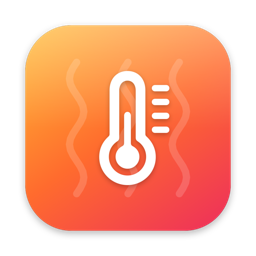
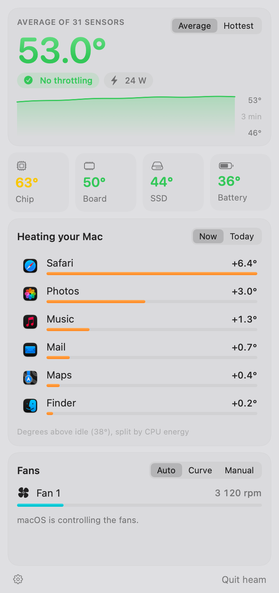
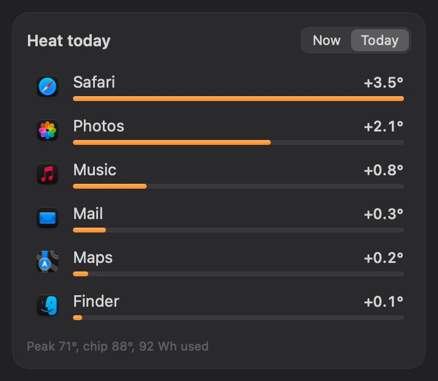

<p align="center">
  
</p>

<h1 align="center">heam</h1>

<p align="center">
  <strong>Your Mac's temperature in the menu bar, and which apps are heating it up.</strong><br>
  Live sensors, per-app heat, power draw, fan curves and alerts. Native, tiny, no network.
</p>

<p align="center">
  <a href="../../releases/latest"></a>
  
  
  
</p>

<p align="center">
  <picture>
    <source media="(prefers-color-scheme: dark)" srcset="docs/popover-dark.png">
    
  </picture>
</p>

---

## Features

**Lives in the menu bar.** Shows the average of every temperature sensor, the hottest one, the chip, power draw or fan speed. Your choice. The thermometer fills as the Mac warms up.

**See what's heating your Mac.** heam measures each app's CPU energy and splits the degrees above your Mac's idle temperature between them. Helper processes count toward their app, so Safari's web pages show up as Safari and Chrome helpers as Chrome.

**Today view.** Which apps added the most heat over the day, with the day's peak temperatures and energy used.

**Every sensor, grouped.** 40+ sensors on Apple Silicon, bucketed into Chip, Board, SSD and Battery. Click a tile for the full list.

**Real power draw.** Whole-system watts from the SMC, and per-app watts from the kernel's energy counters.

**Fan control.** Auto, a temperature **curve** (fans ramp between two temperatures you pick, and macOS takes over below the ramp), or **manual** RPM with Quiet, Balanced and Max presets.

**Alerts.** A notification when the chip stays above your limit, or when macOS starts throttling. It names the app responsible and offers to quit it.

**Throttling indicator.** Shows macOS's own thermal pressure, which is what actually decides when your Mac slows down.

**Widget.** Temperature, power and the top heat sources on your desktop or in Notification Center.

**Light on resources.** About 1–2% CPU and 20–40 MB of memory with the popover closed.

<p align="center">
  
</p>

## Install

1. Download **heam.zip** from the [latest release](../../releases/latest) and unzip it.
2. Drag **heam.app** to your **Applications** folder.
3. The first time, **right-click heam.app → Open**, then confirm. heam isn't notarized by Apple yet, so macOS asks once.

   If macOS still refuses, run this once and open it again:
   ```bash
   xattr -dr com.apple.quarantine /Applications/heam.app
   ```

heam appears in the menu bar. To start it with your Mac, open the gear menu and turn on **Open at Login**.

**Requirements:** an Apple Silicon Mac (M1 or later) on macOS 15 Sequoia or later.

## Using heam

| | |
|---|---|
| **Switch the reading** | *Average* or *Hottest* in the popover header. |
| **Change the menu bar item** | Gear menu → *Menu Bar Shows*. |
| **Set up alerts** | Gear menu → *Alerts*. Pick a temperature, how long it must last, and whether to warn about throttling. *Send Test Alert* checks notifications work. |
| **Control the fans** | Pick *Curve* or *Manual*. The first time, macOS asks for your password to install the fan helper. |
| **Add the widget** | Right-click the desktop → *Edit Widgets* → search "heam". |

### How the heat numbers work

macOS doesn't track temperature per app, so heam estimates it:

1. It remembers the coolest your Mac gets (its **idle** temperature). That slowly drifts up if the Mac never gets that cool again.
2. Every 2 seconds it measures each app's share of CPU energy.
3. The degrees above idle are split between apps by that share.

So if idle is 38°, the Mac is at 48°, and Minecraft uses 60% of CPU energy, Minecraft shows **+6°**. Treat it as "who is responsible for the heat right now", not a lab measurement.

### Fan control and safety

Writing fan speeds needs administrator rights. heam installs a small helper once:

- It's a copy of heam at `/Library/PrivilegedHelperTools/is.bored.heam.fanhelper`, owned by root so nothing else on your account can modify it, and run by `launchd`.
- It only listens on a socket that your user account alone can open.
- If heam quits or stops responding for 20 seconds, the helper hands the fans back to macOS.
- **Gear menu → Remove Fan Helper…** uninstalls it completely.

Don't run another fan app (Macs Fan Control, TG Pro and so on) at the same time. They will fight over the fans.

## Privacy

heam makes **no network connections**. Everything stays on your Mac:

- Settings: `~/Library/Preferences/is.bored.heam.plist`
- Today's history and the widget's data: `~/Library/Application Support/heam/`

## Build from source

You need Xcode 16 or later (Swift 6 toolchain, macOS 15 SDK).

```bash
git clone https://github.com/n1ghtfxll/heam.git
cd heam
./build.sh --install    # builds heam.app with its widget, copies it to /Applications and opens it
```

Other useful commands:

```bash
./build.sh                                    # build into ./build/heam.app only
.build/debug/heam --dump                      # print sensors, fans and top processes, then exit
.build/debug/heam --snapshot /tmp/heam        # render the popover to PNGs
swift scripts/make-icon.swift Resources/AppIcon.icns   # regenerate the app icon
```

### Project layout

| Path | What's there |
|---|---|
| `Sources/CHeam/` | C bridge to the SMC (fans, power) and the private HID API for Apple Silicon temperature sensors |
| `Sources/heam/` | The app: sampling (`Store.swift`), per-app energy (`ProcessMonitor.swift`), fan helper (`FanDaemon.swift`), alerts, history and SwiftUI views |
| `Sources/HeamWidget/` | WidgetKit extension |
| `Sources/HeamShared/` | The snapshot file shared between the app and the widget |
| `Resources/` | App icon, widget `Info.plist` and entitlements |

## Known limitations

- **Apple Silicon only.** Intel Macs expose temperatures differently and aren't supported yet.
- **Not notarized.** Signed locally, so macOS asks before the first launch.
- **Widget refresh.** macOS limits how often widgets update, so the widget can lag a few minutes behind the menu bar.
- **Per-app heat is an estimate** (see above).
